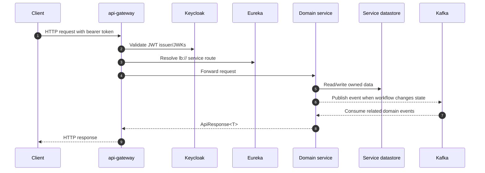
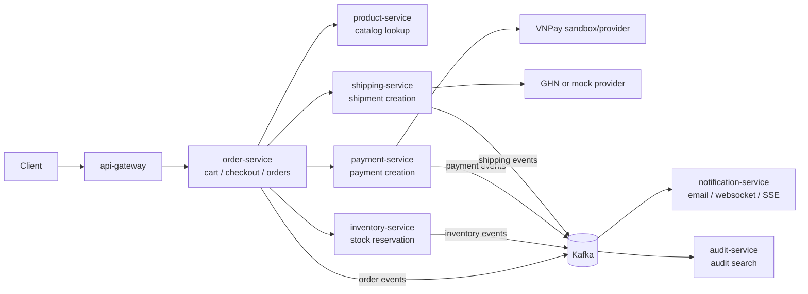

# NexaTech Architecture

This document captures the current repository-level architecture: Spring Cloud services, the NestJS promotion service, FastAPI services, shared infrastructure, and the main sync/async communication paths.

## System Overview

```mermaid
flowchart TB
  client[Frontend / API clients]

  subgraph edge[Edge Layer]
    gateway[api-gateway<br/>Spring Cloud Gateway<br/>:8080]
    kong[_kong/kong.yml<br/>legacy/declarative Kong config]
  end

  subgraph platform[Platform Services]
    discovery[discovery-server<br/>Eureka :8761]
    config[config-server<br/>Spring Cloud Config :8888]
    keycloak[Keycloak :9000]
  end

  subgraph java[Java / Spring Boot Services]
    identity[identity-service :8082]
    user[user-service :8083]
    order[order-service :8084]
    inventory[inventory-service :8085]
    payment[payment-service :8086]
    notification[notification-service :8087]
    storage[storage-service :8088]
    chat[chat-service :8089]
    product[product-service :8090]
    shipping[shipping-service :8091]
    news[news-service :8092]
    audit[audit-service :8096]
  end

  subgraph node[Node.js]
    promotion[promotion-service<br/>NestJS + Prisma<br/>default :8093]
  end

  subgraph python[Python / FastAPI]
    agent[agent-service<br/>default :8093]
    mcp[mcp-server :8094]
    reco[recommendation-service :8095]
  end

  subgraph data[Data and Infrastructure]
    postgres[(PostgreSQL :5432<br/>service databases)]
    mongo[(MongoDB :27017)]
    redis[(Redis :6379)]
    kafka[(Kafka KRaft :9092)]
    minio[(MinIO :9002<br/>console :9003)]
  end

  client --> gateway
  client -. optional legacy path .-> kong

  gateway --> identity
  gateway --> user
  gateway --> product
  gateway --> order
  gateway --> inventory
  gateway --> payment
  gateway --> notification
  gateway --> storage
  gateway --> chat
  gateway --> shipping
  gateway --> news
  gateway --> audit
  gateway --> agent
  gateway --> mcp
  gateway --> reco

  gateway --> keycloak
  identity --> keycloak
  identity --> redis

  java -. register/discover .-> discovery
  gateway -. service discovery .-> discovery
  config -. registers when enabled .-> discovery
  java -. config import .-> config

  user --> postgres
  order --> postgres
  inventory --> postgres
  payment --> postgres
  notification --> postgres
  chat --> postgres
  shipping --> postgres
  news --> postgres
  promotion --> postgres

  product --> mongo
  chat --> mongo
  audit --> mongo
  reco --> mongo

  order --> redis
  inventory --> redis
  chat --> redis
  news --> redis
  promotion --> redis
  reco --> redis

  storage --> minio
  news --> minio

  identity <--> kafka
  user <--> kafka
  product <--> kafka
  order <--> kafka
  inventory <--> kafka
  payment <--> kafka
  shipping <--> kafka
  notification <--> kafka
  news <--> kafka
  audit <--> kafka
  promotion <--> kafka
  reco <--> kafka
```

## Main Runtime Flow

## Checkout-Oriented Domain Flow

## Data Ownership

```mermaid
erDiagram
  POSTGRES ||--o{ USER_SERVICE : nexatech_users
  POSTGRES ||--o{ ORDER_SERVICE : nexatech_orders
  POSTGRES ||--o{ INVENTORY_SERVICE : nexatech_inventory
  POSTGRES ||--o{ PAYMENT_SERVICE : nexatech_payments
  POSTGRES ||--o{ SHIPPING_SERVICE : nexatech_shipping
  POSTGRES ||--o{ NOTIFICATION_SERVICE : nexatech_notifications
  POSTGRES ||--o{ CHAT_SERVICE_SQL : nexatech_chats
  POSTGRES ||--o{ NEWS_SERVICE : nexatech_news
  POSTGRES ||--o{ PROMOTION_SERVICE : nexatech_promotions

  MONGODB ||--o{ PRODUCT_SERVICE : nexatech_products
  MONGODB ||--o{ CHAT_SERVICE_DOCS : nexatech_chats
  MONGODB ||--o{ AUDIT_SERVICE : nexatech_audit
  MONGODB ||--o{ RECOMMENDATION_SERVICE : recommendation

  REDIS ||--o{ IDENTITY_SERVICE : sessions_blacklist
  REDIS ||--o{ ORDER_INVENTORY_CHAT : cache_and_transient_state
  REDIS ||--o{ PROMOTION_SERVICE_CACHE : flash_sale_reservations
  REDIS ||--o{ RECOMMENDATION_CACHE : ranking_cache

  MINIO ||--o{ STORAGE_SERVICE : nexatech_products_bucket
  MINIO ||--o{ NEWS_SERVICE_MEDIA : media_assets
```

## Notes

- `docker-compose.infra.yml` starts local infrastructure only: PostgreSQL, MongoDB, Redis, Kafka, Keycloak and MinIO.
- The root `Makefile` still has `full-up` targets that reference `docker-compose.yml`, but that file is not present in the current snapshot.
- `api-gateway` is the active edge service in local development. `_kong/kong.yml` is useful architecture context, but is not wired by the current infra compose.
- `promotion-service` and `agent-service` both default to `8093`; set `PORT` for one of them when running both locally.
