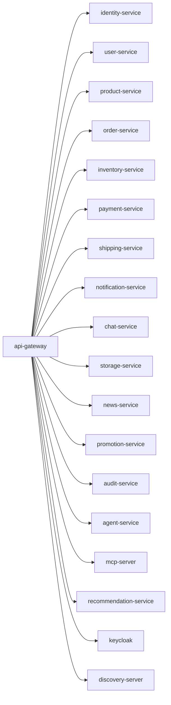

# api-gateway

Spring Cloud Gateway edge service for routing client traffic to backend services.

## Service Graph

## Dependencies

- Service discovery: [discovery-server](../discovery-server/README.md)
- Auth provider: Keycloak (infra)
- Routed services:
  - [identity-service](../identity-service/README.md)
  - [user-service](../user-service/README.md)
  - [product-service](../product-service/README.md)
  - [order-service](../order-service/README.md)
  - [inventory-service](../inventory-service/README.md)
  - [payment-service](../payment-service/README.md)
  - [shipping-service](../shipping-service/README.md)
  - [notification-service](../notification-service/README.md)
  - [chat-service](../chat-service/README.md)
  - [storage-service](../storage-service/README.md)
  - [news-service](../news-service/README.md)
  - [promotion-service](../promotion-service/README.md)
  - [audit-service](../audit-service/README.md)
  - [agent-service](../python-services/agent-service/README.md)
  - [mcp-server](../python-services/mcp-server/README.md)
  - [recommendation-service](../python-services/recommendation-service/README.md)
