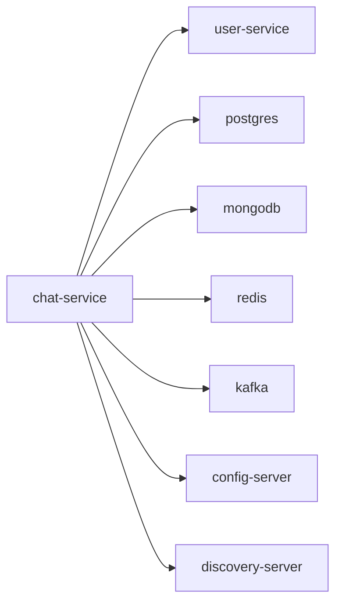

# chat-service

Chat and conversation service (REST + WebSocket).

## Service Graph

## Dependencies

- User profile integration: [user-service](../user-service/README.md)
- Shared platform: [config-server](../config-server/README.md), [discovery-server](../discovery-server/README.md)
- Infra: PostgreSQL, MongoDB, Redis, Kafka
