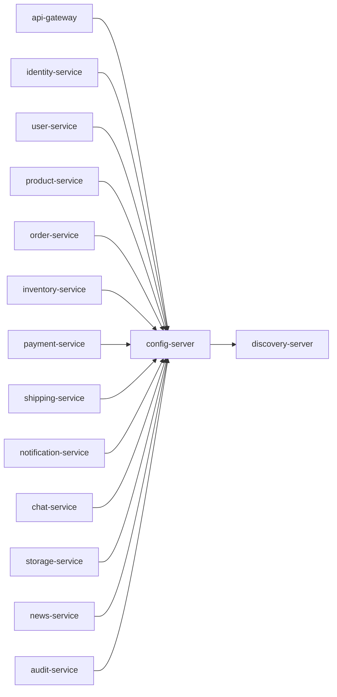

# config-server

Spring Cloud Config Server using native config files under `src/main/resources/configs`.

## Service Graph

## Dependencies

- Optional registry registration: [discovery-server](../discovery-server/README.md)
- Config consumers:
  - [api-gateway](../api-gateway/README.md)
  - [identity-service](../identity-service/README.md)
  - [user-service](../user-service/README.md)
  - [product-service](../product-service/README.md)
  - [order-service](../order-service/README.md)
  - [inventory-service](../inventory-service/README.md)
  - [payment-service](../payment-service/README.md)
  - [shipping-service](../shipping-service/README.md)
  - [notification-service](../notification-service/README.md)
  - [chat-service](../chat-service/README.md)
  - [storage-service](../storage-service/README.md)
  - [news-service](../news-service/README.md)
  - [audit-service](../audit-service/README.md)
