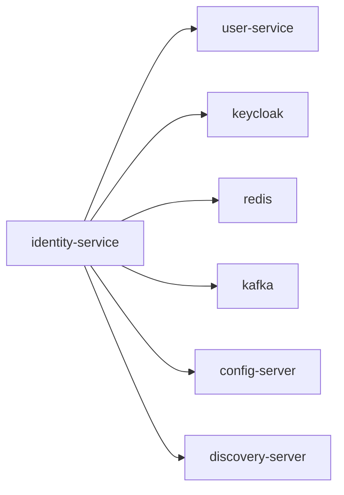

# identity-service

Authentication and IAM facade integrated with Keycloak.

## Service Graph

## Dependencies

- User profile sync: [user-service](../user-service/README.md)
- Shared platform: [config-server](../config-server/README.md), [discovery-server](../discovery-server/README.md)
- Infra: Keycloak, Redis, Kafka
