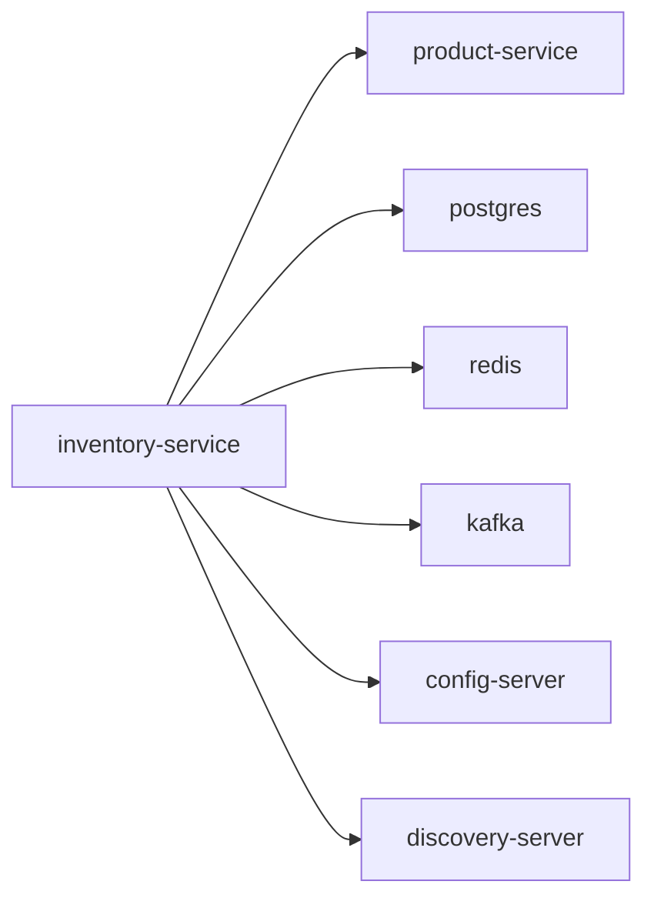

# inventory-service

Inventory and stock reservation service.

## Service Graph

## Dependencies

- Product metadata lookup: [product-service](../product-service/README.md)
- Shared platform: [config-server](../config-server/README.md), [discovery-server](../discovery-server/README.md)
- Infra: PostgreSQL, Redis, Kafka
