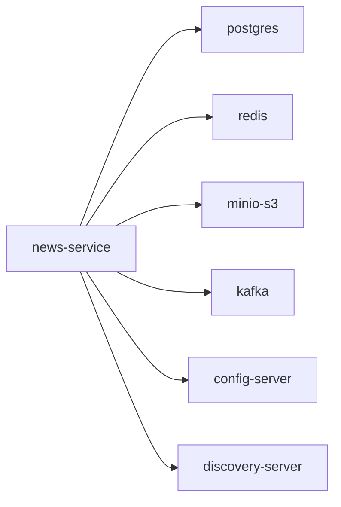

# news-service

News and editorial content service.

## Service Graph

## Dependencies

- Shared platform: [config-server](../config-server/README.md), [discovery-server](../discovery-server/README.md)
- Infra: PostgreSQL, Redis, MinIO/S3, Kafka
