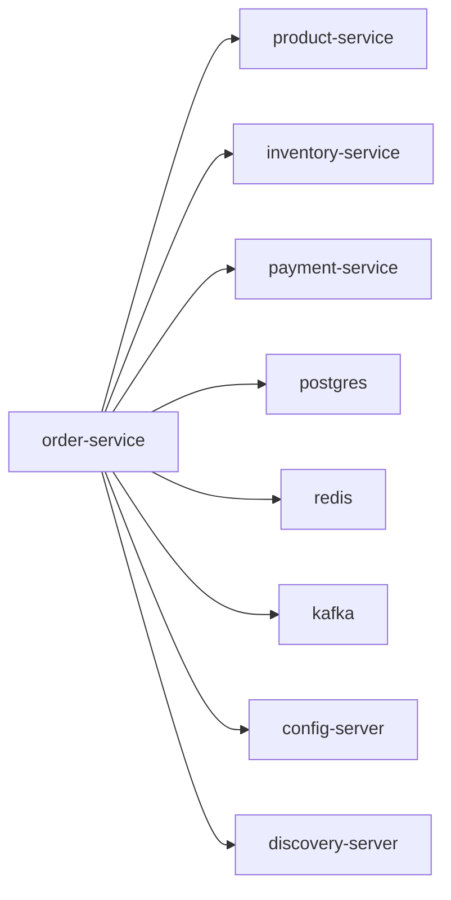

# order-service

Order, cart, checkout, and return orchestration service.

## Service Graph

## Dependencies

- Synchronous orchestration: [product-service](../product-service/README.md), [inventory-service](../inventory-service/README.md), [payment-service](../payment-service/README.md)
- Shared platform: [config-server](../config-server/README.md), [discovery-server](../discovery-server/README.md)
- Infra: PostgreSQL, Redis, Kafka
