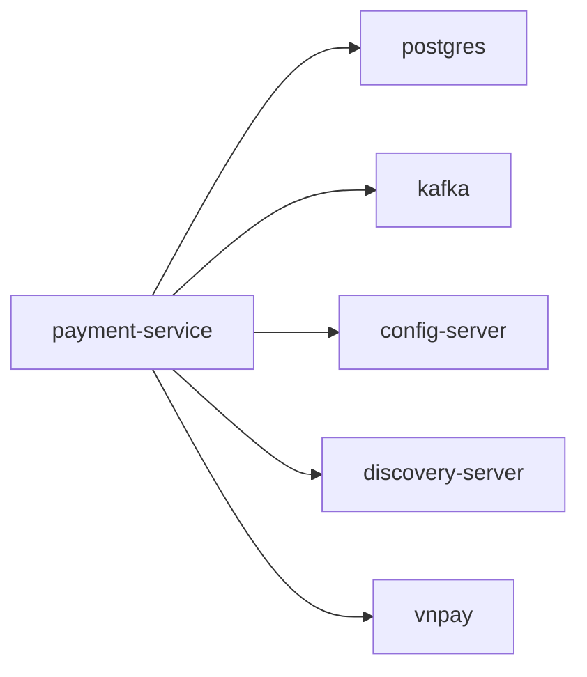

# payment-service

Payment lifecycle service (including VNPay integration).

## Service Graph

## Dependencies

- Shared platform: [config-server](../config-server/README.md), [discovery-server](../discovery-server/README.md)
- Infra: PostgreSQL, Kafka
- External provider: VNPay
