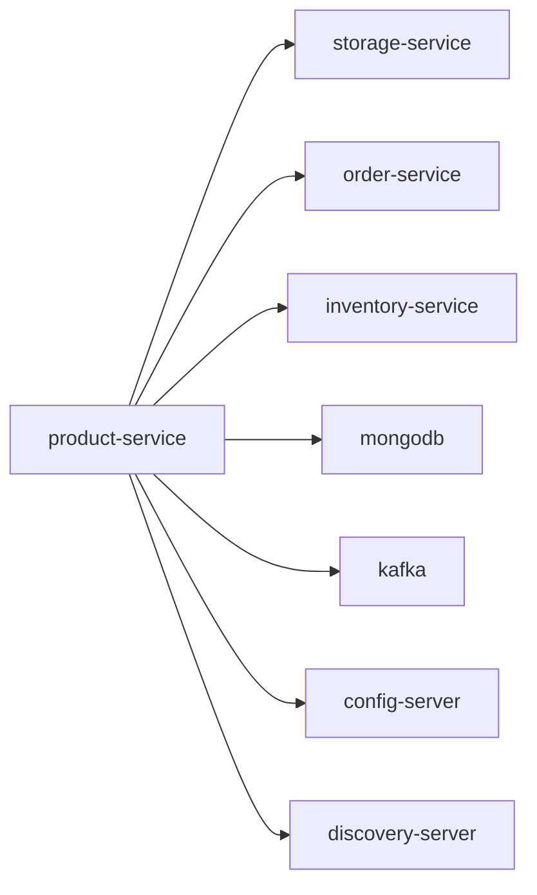

# product-service

Product catalog service (products, categories, brands, reviews, wishlist).

## Service Graph

## Dependencies

- Internal file APIs: [storage-service](../storage-service/README.md)
- Purchase validation / stock checks: [order-service](../order-service/README.md), [inventory-service](../inventory-service/README.md)
- Shared platform: [config-server](../config-server/README.md), [discovery-server](../discovery-server/README.md)
- Infra: MongoDB, Kafka
