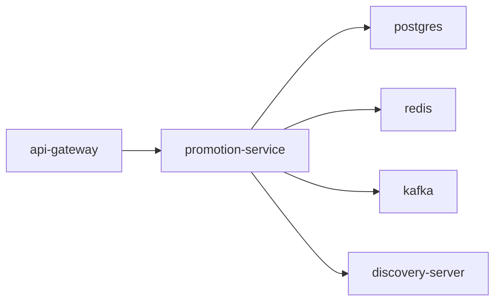

# promotion-service

NestJS service for promotions, coupons, and flash sales.

## Service Graph



## Dependencies

- Exposed through: [api-gateway](../api-gateway/README.md)
- Service discovery: [discovery-server](../discovery-server/README.md)
- Infra: PostgreSQL, Redis, Kafka

## Run

```bash
npm install
npm run generate
npm run migrate:dev
npm run start:dev
```
