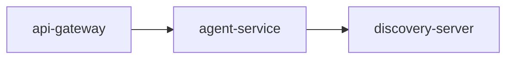

# agent-service

FastAPI service for agent-related APIs.

## Default port

- 8093

## Health endpoint

- GET /health

## Run

```bash
uv run main.py
```

## Environment variables

- SERVICE_NAME=agent-service
- PORT=8093
- EUREKA_ENABLED=true
- EUREKA_SERVER_URL=http://localhost:8761/eureka/
- EUREKA_INSTANCE_HOSTNAME=127.0.0.1

## Service Graph



## Dependencies

- Exposed through: [api-gateway](../../api-gateway/README.md)
- Service discovery: [discovery-server](../../discovery-server/README.md)
