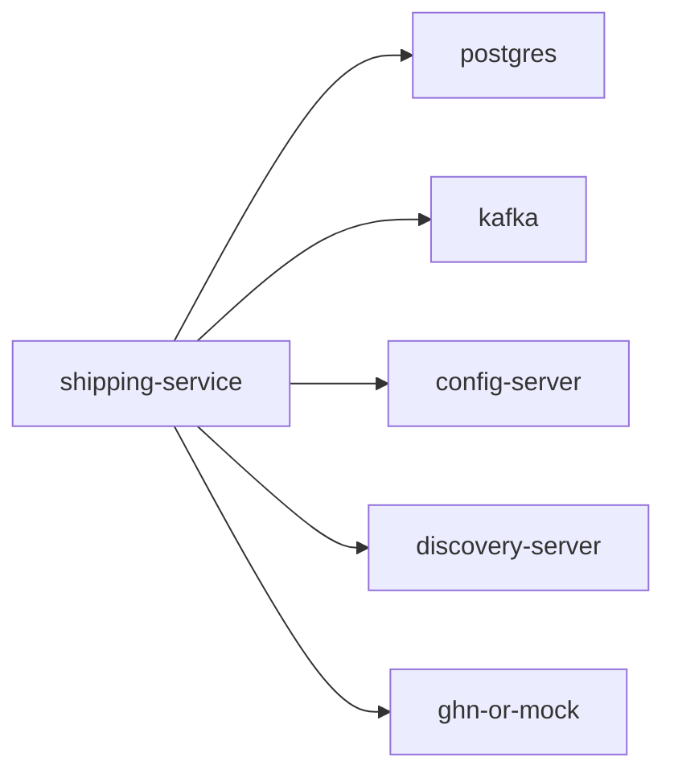

# shipping-service

Shipping quote and shipment management service.

## Service Graph

## Dependencies

- Shared platform: [config-server](../config-server/README.md), [discovery-server](../discovery-server/README.md)
- Infra: PostgreSQL, Kafka
- External provider: GHN or mock shipping adapter
