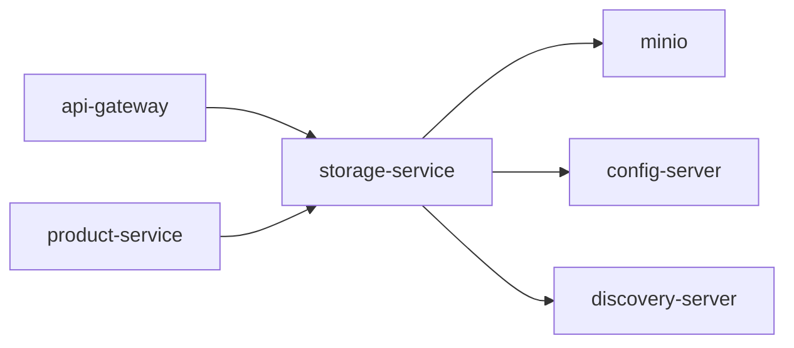

# Storage Service

File upload and retrieval service backed by MinIO (S3-compatible object storage).

## Overview

| Item | Value |
|---|---|
| Port | `8088` |
| Eureka name | `storage-service` |
| Object store | MinIO (AWS SDK v2 S3 client) |
| Default bucket | `nexatech-products` |

The service exposes **internal** endpoints for upload/delete (consumed by other services via Feign) and a **public** streaming endpoint for file retrieval (routed through the API Gateway).

## API Endpoints

### Internal (not exposed through Kong)

| Method | Path | Description |
|---|---|---|
| `POST` | `/internal/files/upload` | Upload a file (multipart) |
| `DELETE` | `/internal/files?bucket=&key=` | Delete a file |

### Public (via API Gateway)

| Method | Path | Description |
|---|---|---|
| `GET` | `/api/v1/files/{bucket}/{key}` | Stream file content |

## Upload Constraints

- **Max file size:** 5 MB
- **Allowed types:** `image/jpeg`, `image/png`, `image/webp`, `image/gif`
- Files are stored with a UUID-based key to prevent collisions

## Configuration

Config is managed via Config Server at `config-server/src/main/resources/configs/storage-service.yml`:

```yaml
minio:
  endpoint: ${MINIO_ENDPOINT:http://localhost:9002}
  access-key: ${MINIO_ACCESS_KEY:nexatech-minio}
  secret-key: ${MINIO_SECRET_KEY:nexatech-minio-secret}
  bucket: ${MINIO_BUCKET:nexatech-products}
  public-url: ${MINIO_PUBLIC_URL:http://localhost:8000}
```

| Property | Description |
|---|---|
| `minio.endpoint` | MinIO S3 API URL (Docker: `http://minio:9000`, local: `http://localhost:9002`) |
| `minio.access-key` | MinIO root user |
| `minio.secret-key` | MinIO root password |
| `minio.bucket` | Default bucket for uploads |
| `minio.public-url` | Base URL for generated file URLs (points to Kong gateway) |

## Infrastructure

MinIO is defined in `docker-compose.infra.yml`:

| Port | Service |
|---|---|
| `9002` → `9000` | S3 API |
| `9003` → `9001` | MinIO Console (web UI) |

Start with:
```bash
make infra-up
# or
docker compose -f docker-compose.infra.yml up -d
```

Access the MinIO Console at `http://localhost:9003` with credentials `nexatech-minio` / `nexatech-minio-secret`.

## Integration Guide — Using from Other Services

### 1. Add OpenFeign dependency

The consuming service needs `spring-cloud-starter-openfeign` in its `pom.xml` (already present in most services).

### 2. Create a Feign client

```java
@FeignClient(name = "storage-service")
public interface StorageClient {

    @PostMapping(value = "/internal/files/upload",
                 consumes = MediaType.MULTIPART_FORM_DATA_VALUE)
    StorageUploadResult upload(
            @RequestPart("file") MultipartFile file,
            @RequestParam(required = false) String bucket);

    @DeleteMapping("/internal/files")
    void delete(@RequestParam String bucket,
                @RequestParam String key);
}
```

The client resolves `storage-service` via Eureka — no hardcoded URLs needed.

### 3. Define response DTOs

```java
@Data
@NoArgsConstructor
@AllArgsConstructor
public class StorageUploadResult {
    private boolean success;
    private FileData data;

    @Data
    @NoArgsConstructor
    @AllArgsConstructor
    public static class FileData {
        private String url;
        private String bucket;
        private String key;
        private long size;
        private String contentType;
    }
}
```

### 4. Use the client

```java
@Service
@RequiredArgsConstructor
public class MyService {

    private final StorageClient storageClient;

    public String uploadImage(MultipartFile file) {
        StorageUploadResult result = storageClient.upload(file, null); // uses default bucket
        return result.getData().getUrl(); // e.g. http://localhost:8000/api/v1/files/nexatech-products/uuid.jpg
    }

    public void deleteImage(String imageUrl) {
        String[] parts = extractBucketAndKey(imageUrl);
        storageClient.delete(parts[0], parts[1]);
    }
}
```

### 5. URL format

Upload responses return URLs in the format:
```
{public-url}/api/v1/files/{bucket}/{key}
```
Example: `http://localhost:8000/api/v1/files/nexatech-products/a1b2c3d4-e5f6-7890-abcd-ef1234567890.jpg`

These URLs are served by the `GET /api/v1/files/{bucket}/{key}` endpoint, routed through the API Gateway.

## Running Locally

1. Start infrastructure: `make infra-up`
2. Start discovery-server, then config-server
3. Run storage-service:
   ```bash
   cd storage-service
   mvn spring-boot:run
   ```
4. Test upload:
   ```bash
   curl -X POST http://localhost:8088/internal/files/upload \
     -F "file=@test-image.jpg"
   ```

## Service Graph



## Dependencies

- Used by: [product-service](../product-service/README.md)
- Exposed through: [api-gateway](../api-gateway/README.md)
- Shared platform: [config-server](../config-server/README.md), [discovery-server](../discovery-server/README.md)
- Infra: MinIO
