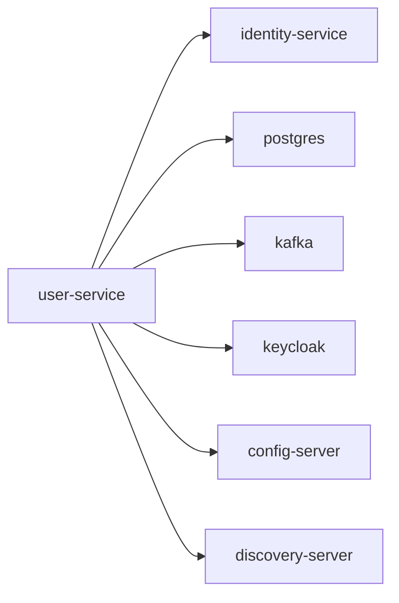

# user-service

User profile, address, role, permission, and group management service.

## Service Graph

## Dependencies

- IAM calls: [identity-service](../identity-service/README.md)
- Shared platform: [config-server](../config-server/README.md), [discovery-server](../discovery-server/README.md)
- Infra: PostgreSQL, Kafka, Keycloak
